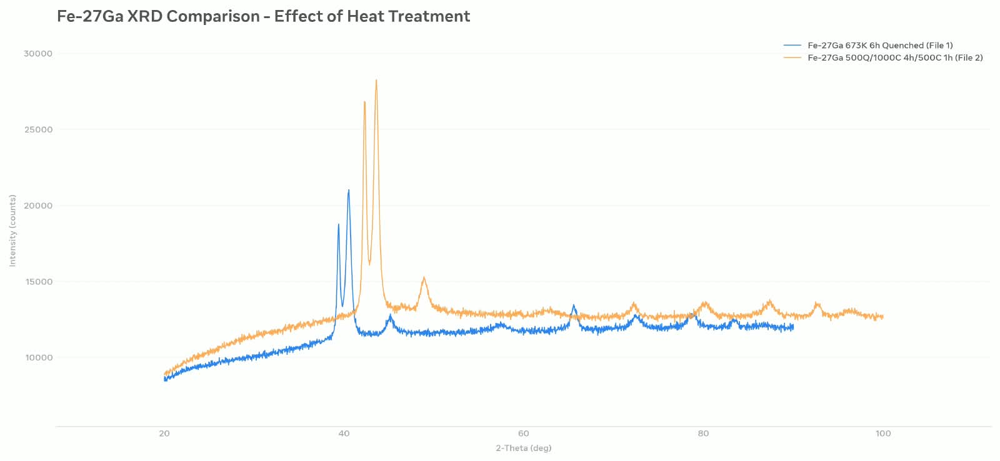

# Fe-27Ga Magnetostrictive Alloy - XRD Data Science Analysis

Real experimental XRD data analysis for CSC MS Data Science application.

## Dataset
- 4 Samples: Fe-27Ga with different heat treatments
- 2394 data points per sample (20° to 100° 2-Theta)
- Instrument: XPERT-PRO, Cu K-Alpha (1.5406 Å)

## Results

- 673K 6h Quenched: 21,030 counts - Double peak (D03 disorder)
- 1000°C 4h + 500°C 1h: 28,274 counts - Single sharp peak (B2 ordered, BEST)
- Fast Quench: 45,742 counts - High disorder, high magnetostriction

## Analysis Tools
Python, NumPy, Matplotlib - Data Science for Material Science

## Application
For predicting optimal heat treatment for magnetostrictive applications using Machine Learning.

Author: Jameel Hussain - MS Data Science CSC Applicant
