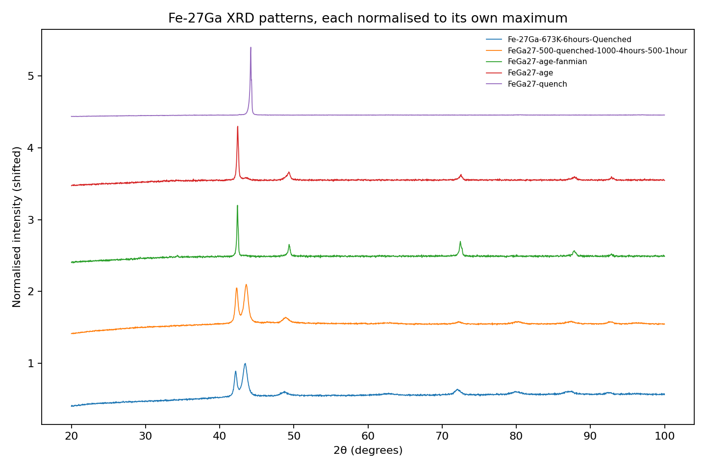

# Fe-27Ga XRD Analysis: how heat treatment changes the crystal structure

Python analysis of powder X-ray diffraction (XRD) scans of an Fe-27Ga (Fe₇₃Ga₂₇) magnetostrictive alloy after different heat treatments. It extends my BS Physics thesis, *"Atomistic Variation of Magnetostriction in Fe-Ga Alloys"* (Karakoram International University, Gilgit), where I plotted this kind of data by hand in Origin. Here the same analysis is scripted so it is repeatable.

## Data

- 5 XRD scans of Fe-27Ga samples with different heat treatments (file names are kept as in the lab):
  `FeGa27-quench`, `Fe-27Ga-673K-6hours-Quenched`, `FeGa27-500-quenched-1000-4hours-500-1hour`, `FeGa27-age`, `FeGa27-age-fanmian`
- Instrument: PANalytical X'Pert PRO, Cu K-alpha1 (1.5406 Å), 2394 points from 20° to 100° 2θ
- The raw files belong to the research group and are **not included** in this repository.

## What the code does

1. Reads the `.xrdml` files (angle axis taken from the file header).
2. Smooths the signal and removes the background.
3. Detects peaks and fits each with a pseudo-Voigt profile.
4. Converts peak positions to d-spacings with Bragg's law.
5. Searches for the cubic lattice parameter that best explains the strong peaks for two families: **FCC-type** (reflections 111, 200, 220, 311, 222; a ≈ 3.6 to 3.8 Å) and **BCC-type** (110, 200, 211, 220; a ≈ 2.85 to 3.0 Å). The BCC-type fit is only applied to peaks the FCC-type fit cannot explain.

## Results



| Sample | Strong peaks found (2θ) | Result |
|---|---|---|
| `FeGa27-quench` | 44.19° only | One dominant peak, consistent with a single BCC-type (110) reflection. Weaker peaks are not distinguishable from noise. |
| `Fe-27Ga-673K-6hours-Quenched` | 42.16°, 43.43°, 72.09°, 80.0°, 87.12°, 92.46° | Mixture: FCC-type phase (a ≈ 3.704 Å) plus BCC-type phase (a ≈ 2.940 Å). |
| `FeGa27-500-quenched-1000-4hours-500-1hour` | 42.30°, 43.58°, 48.92°, 72.25°, 80.16°, 87.33° | Mixture: FCC-type (a ≈ 3.704 Å) plus BCC-type (a ≈ 2.933 Å). |
| `FeGa27-age` | 42.43°, 49.28°, 72.51°, 87.81°, 92.88° | FCC-type phase only (a ≈ 3.686 Å); no BCC-type peaks detected. |
| `FeGa27-age-fanmian` | 42.41°, 49.37°, 72.48°, 87.83° | FCC-type phase only (a ≈ 3.687 Å); no BCC-type peaks detected. |

**Main observation:** the heat treatment changes which crystal structure dominates. The quenched sample shows a single BCC-type peak, the aged samples are dominated by an FCC-type phase, and the intermediate treatments show both. This matches the dependence of phase formation on thermal history described in my thesis.

Full peak tables are in `results/` and the zoom around the strongest reflections is in `figures/zoom_40_52.png`.

## Limitations

- Phase labels are **candidate labels** from peak positions only. Proper identification needs reference patterns and Rietveld refinement.
- Lattice parameters come from 2 to 4 peaks each and are approximate.
- Peak heights are **not comparable between samples**: the counting time differs (about 50 s for one scan, 10 s for two others, unknown for the last two).
- Two files contained only intensity counts without an angle header. For those, the scan range of the other files (same 2394 points) was assumed. The peak positions are physically sensible, but this should be confirmed from the instrument files.
- No magnetostriction measurements are analysed here, so **this repository makes no claim about magnetostriction values**.
- B2/D0₃ ordering peaks are weak and are not reliably detectable at this signal level.

## Reproduce

```bash
pip install -r requirements.txt
# put your own .xrdml files in data/real/, then:
python src/analyze_samples.py data/real
```

A synthetic demo is also included (`data/*_SYNTHETIC.csv`, generated by `src/make_demo_data.py`). It is artificial and is only used to test the code. Run it with `python src/run_analysis.py --input data/demo_ordered_SYNTHETIC.csv`.

## Next steps

- Combine the XRD features (lattice parameters, phase mix) with measured magnetostriction values, if available, and test simple regression models.
- Add reference-pattern matching and a Jupyter notebook walkthrough.

## Author

Jameel Hussain, BS Physics, Karakoram International University. Contact: jameelhussain5577@gmail.com
